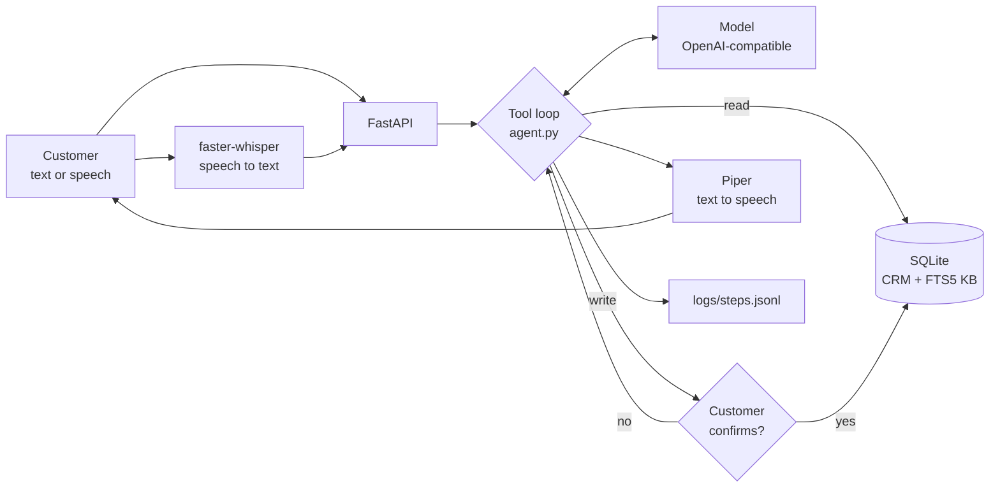

# voice-support-agent

A customer support agent you can type or talk to. It answers from a knowledge base with a source, acts on a fake CRM, asks before it changes anything, and hands off to a human with a summary.

The tool-calling loop uses no agent framework. By default everything runs on your machine with a local model, so it needs no API key and costs nothing. All data is synthetic. The project was built with Claude Code.



## Results

Measured on an Apple Silicon Mac with `qwen3.5:4b` through Ollama, one run per scenario.

| Scenario set | Who wrote it | Task completion | False action claims | Wrong language | Report |
|---|---|---|---|---|---|
| Independent set 2 (20) | OpenAI Codex, without seeing the code | **16/20 (80%)** | 0/20 | 0/20 | [HOLDOUT-2](eval/HOLDOUT-2.md) |
| Independent set 1 (20) | OpenAI Codex, flawed brief | 9/20 (45%) | 2/20 | 0/20 | [HOLDOUT-1](eval/HOLDOUT-1.md) |
| Development set (47) | Written alongside the code | 43/47 (91%) | 1/47 | 0/47 | [REPORT](eval/REPORT.md) |

Trust the independent sets over the development set. The code was fixed against the development set, and two runs of the same code on it scored 45/47 and 43/47, so a small model varies by a few points from run to run.

Set 1 is published as it ran, with nothing changed. Many of its 11 failures came from the brief it was given: it did not give the knowledge base file names, and it let scenarios forbid a tool that has to be called before the customer can decline. Some failures were real, such as a needless handoff and a missing return fee. Set 2 used a corrected brief and the same code, and it was run once. No human has written a scenario set yet. To add one, use the same format and run `uv run python eval/run.py --scenarios your.json --name YOURS`.

The word lists in the checks are approximate. They produced false alarms in earlier runs and some remain in the reports. For example, `kb-12` is flagged for a sentence about "address change rules" that claims nothing.

Latency per customer turn was 6.5 s at p50 and 18.1 s at p95 on set 2. Turning model thinking off with `LLM_REASONING_EFFORT=none` cut p50 latency by more than half and output tokens by 68% on an earlier version, but task completion fell from 44/47 to 40/47, so thinking stays on.

Spoken turns, measured on an earlier version over 6 turns of synthetic speech from macOS `say` on CPU (median, and slowest total):

| Speech to text | Agent | Text to speech | Total | Slowest total |
|---|---:|---:|---:|---:|
| 483 ms | 3,644 ms | 178 ms | 4,834 ms | 5,948 ms |

## How the loop works

The core is `_run` in [agent.py](agent.py):

1. Send the conversation and the tool list to the model.
2. Keep the model's full reply, because tool results must point at its call ids.
3. If there are no tool calls, check the answer, then return it.
4. Run read tools straight away. Hold write tools and return them to the caller.
5. `confirm()` runs or declines one held write at a time, then resumes the loop.

These rules are in code, so the model cannot talk its way around them:

- **Confirmation.** `update_address`, `create_ticket` and `escalate_to_human` run only after a yes. Each write gets its own answer. By voice, only a one-word yes or no counts.
- **One customer per conversation.** The first email the customer writes is taken as theirs. Other customers' accounts and orders are refused.
- **No invented addresses.** An address needs a house number, street and city, and every word must come from the customer. Otherwise it is rejected before the customer is asked.
- **Replies are checked against what happened.** A reply that claims an action which did not run, or that is in the wrong language, goes back to the model once. A false claim that repeats is replaced with an honest message. These checks use phrase lists for English and Turkish, so a rewording can slip through. `Reply.actions` always reports the writes that really ran, and the demo page shows them.
- **Spending limits.** `MAX_STEPS` stops a run after 8 model calls, and messages and recordings have size limits.

The model keeps no state, so every call resends the conversation. `_view` bounds that: only the last 3 customer turns go out in full, older ones shrink to a short digest, and old reasoning text is dropped. On one 10-turn conversation this took the last call from 2,520 to 1,835 input tokens and the total from 33,003 to 28,696. The full history stays in memory for the handoff transcript. Growth inside a single turn remains, because the model has to see its tool results.

## Run it

You need [uv](https://docs.astral.sh/uv/) and [Ollama](https://ollama.com).

```bash
ollama pull qwen3.5:4b
uv run uvicorn app:app
```

Open http://127.0.0.1:8000 and try `deniz@example.com` with order `O5001`. Delete `crm.db` to reset the data. Every step of a run is appended to `logs/steps.jsonl`, with tokens and latency for each model call. `GET /handoffs` shows the queue a human agent would work from.

To use voice, install the extra and fetch the Piper voices (about 63 MB each). The Whisper model downloads on first use.

```bash
uv sync --extra voice
```

```bash
uv run --extra voice python -m piper.download_voices --data-dir voices en_US-lessac-medium tr_TR-dfki-medium
```

```bash
uv run --extra voice uvicorn app:app
```

To use another backend, set `LLM_BASE_URL`, `LLM_MODEL` and `LLM_API_KEY` in the environment. Any OpenAI-compatible endpoint with tool calling should fit, but only the local default has completed a run so far.

## Evaluate and test

Tests use a scripted fake model and need no model at all:

```bash
uv run pytest
```

The evaluation runs a scenario file against the configured model and rewrites its report. The default is the development set:

```bash
uv run python eval/run.py
```

## MCP server

The same CRM and knowledge base are available to any MCP host over stdio. There the host runs the loop, so its tool approval is the human gate.

```bash
uv run --extra mcp python mcp_server.py
```

## Known limits

- **No real authentication.** Knowing an email is enough to act as that customer. A real deployment needs a login or a verification step. Run this locally only.
- **Duplicate handoffs.** On set 2 (`i-20`) one conversation queued two handoffs. Nothing stops this yet.
- **Keyword search, not vectors.** The knowledge base uses SQLite FTS5. That suits these 17 short sections but finds no paraphrases on its own, and Turkish questions depend on the model translating its search.
- **Microphone not tried with a person.** Voice was tested with synthetic speech files, and the browser recording format with a tone.
- **Speech accuracy.** With the default `base` model, a spoken email address came out wrong ("denizettexample.com"), and a short Turkish phrase was garbled once. Typing the email works better. The larger `small` model was about 3 times slower and no better on the same 6 turns.
- **Weak local model.** `qwen3.5:4b` is small, and its Turkish can be awkward.
- **A source is evidence, not proof.** Code picks the search result that shares the most words with the reply, so it does not prove the reply came from it.
- **One model measured.** Only the local model has completed a run. No hosted model has been measured.
- **No phone line.** Voice runs in the browser; there is no SIP or telephony.
- **Single process.** Sessions live in memory behind one lock and are lost on restart.
- **Docker is untested.** The `Dockerfile` has not been built yet. It expects Ollama on the host. If you run it, publish the port to localhost only: `docker run -p 127.0.0.1:8000:8000`.

## License

MIT, see [LICENSE](LICENSE). The optional `voice` extra installs `piper-tts`, which is GPL-3.0-or-later. This repository does not include it, but keep that in mind if you redistribute a build with voice.
