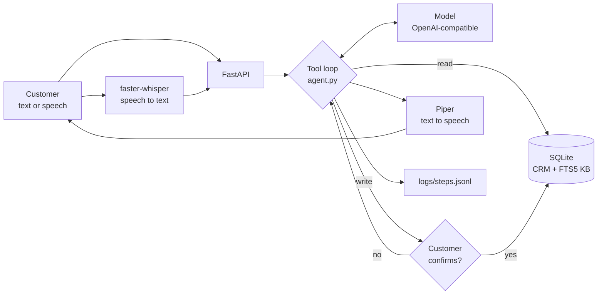

# voice-support-agent

A customer support agent you can type or talk to. It answers from a knowledge base with a source, acts on a fake CRM, asks before it changes anything, and hands off to a human with a summary.

The tool-calling loop is hand-written, with no agent framework. By default everything runs on your machine with a local model, so it needs no API key and costs nothing. All data is synthetic.



## Results

Measured on an Apple Silicon Mac with `qwen3.5:4b` through Ollama. Full output: [eval/REPORT.md](eval/REPORT.md).

| 47 synthetic scenarios, one run each | Result |
|---|---|
| Task completion (every check passed) | 45/47 (96%) |
| Correct tool use | 46/47 |
| Correct handoff decision | 6/6 |
| Reply carries the right source | 10/11 |
| Latency per customer turn, p50 / p95 | 4.4 s / 8.0 s |

Read these numbers with care. I wrote the scenarios and fixed problems they exposed, so this is not a held-out test. The first run scored 44/47, including a real leak of another customer's address, and the fix for that is in the code now. The source check mostly measures search, because code adds the source to the reply (the model forgot it in 9 of 11 replies when asked to do it).

Turning model thinking off with `LLM_REASONING_EFFORT=none` cut p50 latency from 4.2 s to 1.8 s and output tokens by 68%, but task completion fell from 44/47 to 40/47 on the code as it was then. Thinking stays on by default.

Spoken turns, measured over 6 turns of synthetic speech from macOS `say` on CPU (median, and slowest total):

| Speech to text | Agent | Text to speech | Total | Slowest total |
|---|---:|---:|---:|---:|
| 483 ms | 3,644 ms | 178 ms | 4,834 ms | 5,948 ms |

## How the loop works

The core is `_run` in [agent.py](agent.py):

1. Send the conversation and the tool list to the model.
2. Keep the model's full reply, because tool results must point at its call ids.
3. If there are no tool calls, that is the answer.
4. Run read tools straight away. Hold write tools and return them to the caller.
5. `confirm()` runs or declines one held write at a time, then resumes the loop.

Rules the model cannot talk its way around, because they are in code:

- **Confirmation.** `update_address`, `create_ticket` and `escalate_to_human` run only after a yes. Each write gets its own answer. By voice, only a one-word yes or no counts.
- **One customer per conversation.** The first successful lookup fixes the customer. Other customers' data is refused after that.
- **Address shape.** An address without a house number, street and city is rejected before the customer is even asked.
- **Spending limits.** `MAX_STEPS` stops a run after 8 model calls, and messages and recordings have size limits.

The model keeps no state, so every call resends the conversation. `_view` bounds that: only the last 3 customer turns go out in full, older ones shrink to a short digest, and old reasoning text is dropped. On one 10-turn conversation this took the last call from 2,520 to 1,835 input tokens and the total from 33,003 to 28,696. The full history stays in memory for the handoff transcript. Growth inside a single turn remains, because the model has to see its tool results.

## Run it

You need [uv](https://docs.astral.sh/uv/) and [Ollama](https://ollama.com).

```bash
ollama pull qwen3.5:4b
uv run uvicorn app:app
```

Open http://127.0.0.1:8000 and try `deniz@example.com` with order `O5001`. Delete `crm.db` to reset the data. Every step of a run is appended to `logs/steps.jsonl`, with tokens and latency for each model call. `GET /handoffs` shows the queue a human agent would work from.

To use voice, install the extra and fetch the Piper voices (about 63 MB each). The Whisper model downloads on first use.

```bash
uv sync --extra voice
```

```bash
uv run --extra voice python -m piper.download_voices --data-dir voices en_US-lessac-medium tr_TR-dfki-medium
```

```bash
uv run --extra voice uvicorn app:app
```

To use another backend, set `LLM_BASE_URL`, `LLM_MODEL` and `LLM_API_KEY` in the environment. Any OpenAI-compatible endpoint with tool calling should fit, but only the local default has completed a run so far.

## Evaluate and test

Tests use a scripted fake model and need no model at all:

```bash
uv run pytest
```

The evaluation runs every scenario in [eval/scenarios.json](eval/scenarios.json) against the configured model and rewrites the report:

```bash
uv run python eval/run.py
```

## MCP server

The same CRM and knowledge base are available to any MCP host over stdio. There the host runs the loop, so its tool approval is the human gate.

```bash
uv run --extra mcp python mcp_server.py
```

## Known limits

- **No real authentication.** Knowing an email is enough to act as that customer. A real deployment needs a login or a verification step. Run this locally only.
- **Speech accuracy.** With the default `base` model, a spoken email address came out wrong ("denizettexample.com"), and a short Turkish phrase was garbled once. Typing the email works better. The larger `small` model was about 3 times slower and no better on the same 6 turns.
- **Weak local model.** `qwen3.5:4b` is small, and its Turkish can be awkward.
- **Source shows retrieval only.** The source on a reply is the top search hit. It does not prove the answer used it.
- **No phone line.** Voice runs in the browser; there is no SIP or telephony.
- **Single process.** Sessions live in memory behind one lock and are lost on restart.
- **Docker is untested.** The `Dockerfile` has not been built yet. It expects Ollama on the host. If you run it, publish the port to localhost only: `docker run -p 127.0.0.1:8000:8000`.

## License

MIT, see [LICENSE](LICENSE). The optional `voice` extra installs `piper-tts`, which is GPL-3.0-or-later. This repository does not include it, but keep that in mind if you redistribute a build with voice.
